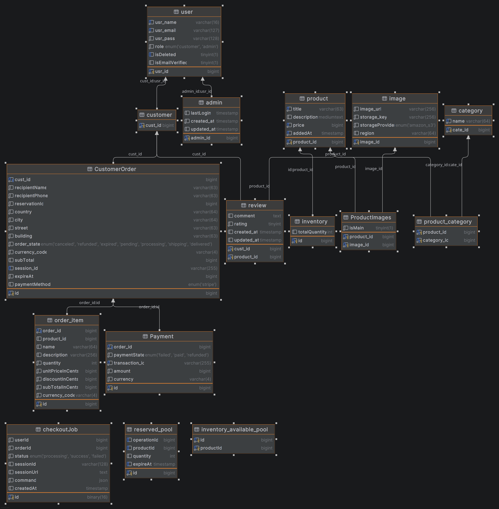

# E-Commerce REST API

A e-commerce REST API built with **Spring Boot**, **Spring JPA**, **Hibernate**, **Spring Security**, **Redis** and **MySQL**.  
Supports product management, categories, cart, orders, checkout with Stripe payment Gateway, integration with Amazon S3 for efficient image storage and management.

-------------------------

## Inventory Reservation & Concurrency

Designed a concurrent inventory reservation system using MySQL `SELECT ... FOR UPDATE SKIP LOCKED` and a bounded available-stock pool to reduce  storage overhead.

- **Concurrent reservations:** Allows transactions to claim different inventory units without waiting on locks held by other transactions.
- **Bounded inventory pool:** Maintains approximately 500–1,000 unit rows per product, replenishing the pool when needed.
- **Coordinated refills:** Combines database row locking with application-level request collapsing to avoid redundant refill operations and db connection.
- **Benchmark:** Achieved approximately **1,135 requests/second** with 50 concurrent clients in a local test of 10,000 checkout requests.

See [Inventory Reservation Benchmark](benchmark/CheckoutBenchmark.md) for more details.

## Checkout test

https://github.com/user-attachments/assets/e8e6f7ed-4961-4d20-bcfe-076ca80a31a0


## Database schema


-------------------

## Features
- **User Authentication:** Registration & login using JWT with Spring Security filters (stateless authentication)
- **Product Management:**
    - Public: Search, pagination, sorting, filtering, view product details
    - Admin: Create, update products
- **Image Management(Admin):**
    - Admin: upload and delete images to amazon s3 storage ,  attach images , set main image for a product
- **Category Management (Admin):** CRUD operations
- **Inventory & Stock Management:**
    - Dedicated endpoints to re-stock, adjust inventory
    - public endpoint to check available stock
- **In-Memory Cart Management:** Fast, low-latency cart operations stored in Redis, bypassing database load until checkout.
- **Checkout :** Stripe payment integration
- **Order Management:** View orders, get order details, cancel orders
- **Security:** JWT-secured endpoints; admin-only access where applicable

----------------
--------
## API Documentation — Swagger UI

The API is documented using OpenAPI 3 and can be explored  through Swagger UI.
After running the application, visit:
    http://localhost:8080/swagger-ui/index.html

The generated OpenAPI specification is also available at:
    http://localhost:8080/v3/api-docs


---
## To Do / Future Improvements
- [X]  Implement product images end points and integrate with amazon s3 cloud storage
- [X]  Add caching for product queries to improve performance
- [X]  Optimize checkout and inventory reservation for concurrent users
- [ ]  implement email verification feature 
- [ ]  Add email notifications for order creation, shipment, and cancellation
- [ ]  integration with shipping service
- [ ]  Expand Admin Dashboard with charts and insights for orders, revenue, and products  
- [ ]  Implement product reviews and ratings  
- [X]  Use docker and docker compose to simplify setup and deployment
## Running with Docker
### Configuration

1.  Clone the repository:
    ```sh
    git clone https://github.com/youssef-khogaly/E-learning-Platform.git
    cd E-learning-Platform
    ```

   2.  Create the backend environment file at `source_code/backend.env` with your credentials:
       ```env
       # Database Configuration
       DB_IP=db-sql-service
       DB_PORT=3306
       DB_SchemaName=E_learning
       DB_USER=your_db_user
       DB_PASS=your_db_password

       # Security
       JWT_SECRET=your_super_secret_jwt_key_with_at_least_256_bits_of_entropy

       # External Service API Keys
       StripeApisec=sk_your_stripe_secret_key
       StripeWhsec=whsec_your_stripe_webhook_secret
            
       # AWS
       AWS_SECRET_ACCESS_KEY=
       AWS_ACCESS_KEY_ID=
       AWS_REGION=
       cloud.aws.bucket.name=
       AWS_ENDPOINT=http://localstack-main:4566
       cloud.aws.bucket.name=public-images
        
       # Redis
    
       REDIS_HOST=
       REDIS_PORT=
       REDIS_PASSWORD=
    
       ```

3.  Create the database environment file at `./db-sql/db-sql`:
    ```env
    MYSQL_ROOT_PASSWORD=your_root_password
    MYSQL_DATABASE=E_Commerce
    MYSQL_USER=your_db_user
    MYSQL_PASSWORD=your_db_password

    ### Running the Application
4. create local stack environment file at `./localStack.env`
    ```env
   BUCKET_NAME="public-images"
   LOCALSTACK_AUTH_TOKEN=
   
5. Build the application's JAR file using Maven:
    ```sh
    cd source_code
    ./mvnw clean package
    ```

5. Start the application and the MySQL database using Docker Compose:
    ```sh
    docker-compose up --build -d
    ```

6. Stripe webhook 
   1. install Striple CLI https://docs.stripe.com/stripe-cli/install
   2. login to stripe account and forward webhook
       ```bash
           stripe login
           stripe listen --events checkout.session.completed,checkout.session.expired --forward-to localhost:8080/api/webhooks/stripe

       ```
  3. do not forget to set StripeWhsec enviroment variable to the webhook secret
## Tech Stack
- **Backend:** JAVA 17 ,Spring Boot, Spring JPA, Hibernate, Spring MVC , Spring Security, JWT
- **Database:** MySQL
- **Caching:** Redis
- **Payment Gateway:** Stripe
- **Cloud storage:** Amazon s3
- **Build Tool:** Maven  Docker Docker-compose
- **Local S3 Testing:** LocalStack
