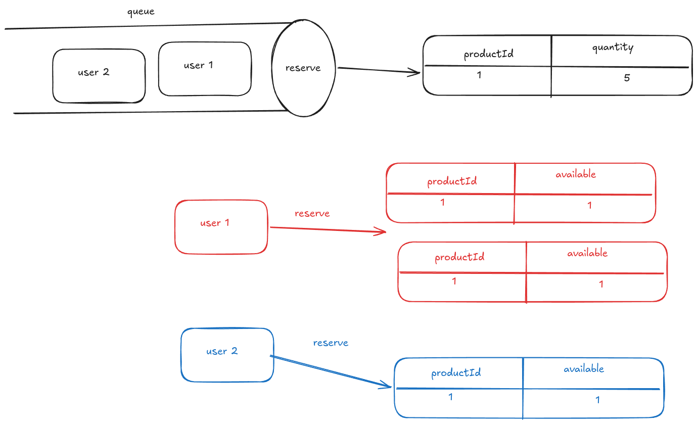
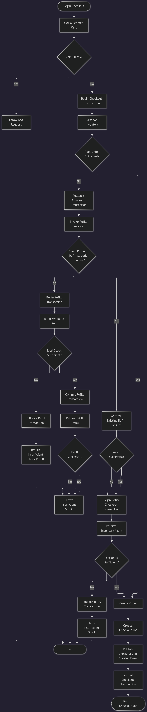

Problem:


During a flash sale, an e-commerce application may receive hundreds or even thousands of concurrent requests trying to purchase the same product.


### Current Approach

The current implementation uses:

Pessimistic locking to prevent concurrent requests from overselling the available stock.
Synchronous Stripe payment-session generation during checkout.

```bash
ab -n 500 -c 50    -T "application/json"    -p body.json    -H "Authorization: $AUTH_TOKEN"    http://localhost:8080/api/me/checkout


Server Software:        
Concurrency Level:      50
Time taken for tests:   13.444 seconds
Complete requests:      500
Failed requests:        250
   (Connect: 0, Receive: 0, Length: 250, Exceptions: 0)
Non-2xx responses:      250
Total transferred:      326500 bytes
Total body sent:        326000
HTML transferred:       189000 bytes
Requests per second:    37.19 [#/sec] (mean)
Time per request:       1344.445 [ms] (mean)
Time per request:       26.889 [ms] (mean, across all concurrent requests)
Transfer rate:          23.72 [Kbytes/sec] received
                        23.68 kb/s sent
                        47.40 kb/s total
```

The checkout flow currently performs stock reservation and payment-session generation synchronously.

Checkout Request:

      │
      ├── Stock Reservation
      │       └── MySQL transaction / locking
              └── create order
      │
      └── Payment Session Generation
              └── Stripe API

At 50 concurrent requests, the current implementation reaches approximately 37 RPS, while 284 requests failed out of 500 !!.


Stripe rate limiting also makes synchronous payment-session generation a potential throughput bottleneck as stripe rate limit in Sandbox allows only: 25 requests per second only!!

### Benchmark 2 - Mocking External Api

lets mock payment session creation for now to foucas on stock locking limitation

```bash

ab -n 500 -c 50    -T "application/json"    -p body.json    -H "Authorization: $AUTH_TOKEN"    http://localhost:8080/api/me/checkout

Document Path:          /api/me/checkout
Document Length:        87 bytes

Concurrency Level:      50
Time taken for tests:   2.525 seconds
Complete requests:      500
Failed requests:        1
   (Connect: 0, Receive: 0, Length: 1, Exceptions: 0)
Total transferred:      180997 bytes
Total body sent:        326000
HTML transferred:       43497 bytes
Requests per second:    198.01 [#/sec] (mean)
Time per request:       252.509 [ms] (mean)
Time per request:       5.050 [ms] (mean, across all concurrent requests)
Transfer rate:          70.00 [Kbytes/sec] received
                        126.08 kb/s sent
                        196.08 kb/s total
```

now much better we can handle 198 request per second 


### Benchmark 3 - Optimistic locking with retries

now we use Pessimistic locking with retries with random backoff between
10 ms to 500 ms, maximum retries 10

```bash

Concurrency Level:      100
Time taken for tests:   21.068 seconds
Complete requests:      500
Failed requests:        280
   (Connect: 0, Receive: 0, Length: 280, Exceptions: 0)
Non-2xx responses:      280
Total transferred:      225680 bytes
Total body sent:        326000
HTML transferred:       88180 bytes
Requests per second:    23.73 [#/sec] (mean)
Time per request:       4213.513 [ms] (mean)
Time per request:       42.135 [ms] (mean, across all concurrent requests)
Transfer rate:          10.46 [Kbytes/sec] received
                        15.11 kb/s sent
                        25.57 kb/s total

```
There is no significant performance improvement. 
But why?

Because changing the locking strategy did not solve the root cause.

The main bottleneck is still database connection pool exhaustion.

With 50 concurrent checkout requests, all 50 connections in the HikariCP pool can become occupied:

total=50, active=50, idle=0

Additional requests have to wait for an available database connection. If a connection is not available within the configured timeout, the request fails:
and also 
Connection is not available,
request timed out after 5000ms

The root cause is not simply the type of database lock being used. The root cause is that high-concurrency checkout requests require database connections while waiting to acquire a lock on the same row so we need to make the checkout transaction fast as possible to not hold db connection for long time


## Inventory Reservation Under High Concurrency

Instead of storing each product's stock quantity in a single inventory row, we represent stock as individual unit rows. During reservation, we use MySQL's `SELECT ... FOR UPDATE SKIP LOCKED` to allow concurrent transactions to claim different units without waiting for locks on units already claimed by other transactions.



### Bounded Available-Stock Pool

Maintaining one row per unit across the entire inventory would consume excessive storage at scale. To address this, we introduce a separate **available-stock pool** that the reservation system uses to claim units. We cap the pool at approximately 500–1,000 unit rows per product, rather than representing the entire inventory as unit-level rows.

When the pool cannot satisfy a reservation, the system invokes a refill service.

### Pool Refills

To prevent concurrent refills for the same product, the refill service locks the product's primary inventory row. This serializes refill operations for that product at the database level.

Before starting a refill transaction, the application also uses **request collapsing**: concurrent requests for the same refill key share the in-flight operation's result. Only the request that initiates the refill performs the database work; the others wait for its result without opening their own refill transactions or consuming additional database connections while waiting.

The refill service also checks the available pool before inserting more unit rows. If the pool is already above the refill threshold, it returns without refilling. This avoids redundant work when another refill has completed  earlier.


## Checkout flow chart




## Checkout final Benchmark

The benchmark was performed using ApacheBench with a database connection pool of 50 connections. The application, MySQL database, and ApacheBench all ran on the same machine.


```bash
ab -n 500 -c 50 -T "application/json" \
   -p body.json \
   -H "Authorization: $AUTH_TOKEN" \
   http://localhost:8080/api/me/checkout
```

```bash
Concurrency Level:      50
Time taken for tests:   0.454 seconds
Complete requests:      500
Failed requests:        0
Requests per second:    1102.38 [#/sec] (mean)
Time per request:       45.357 [ms] (mean)
Time per request:       0.907 [ms] (mean, across all concurrent requests)

Connection Times (ms)
              min  mean[+/-sd] median   max
Connect:        0    1   1.4      0       9
Processing:    17   42  11.7     41      83
Waiting:       14   41  11.5     40      83
Total:         17   43  11.6     42      83
```

The system processed approximately **1,102 requests per second**, with no failed requests and a maximum observed response time of 83 ms.

Compared with the single-row approach's reported throughput of  198.01 requests per second, this is approximately  a 556% increase,  at same load.


 Benchmark 2: 10,000 Requests, 50 Concurrent Clients

``` bash
ab -n 10000 -c 50 -T "application/json" \
   -p body.json \
   -H "Authorization: $AUTH_TOKEN" \
   http://localhost:8080/api/me/checkout
```

``` bash
Concurrency Level:      50
Time taken for tests:   8.813 seconds
Complete requests:      10000
Failed requests:        6
Requests per second:    1134.69 [#/sec] (mean)
Time per request:       44.065 [ms] (mean)
Time per request:       0.881 [ms] (mean, across all concurrent requests)

Connection Times (ms)
              min  mean[+/-sd] median   max
Connect:        0    1   1.1      0      11
Processing:    14   43  13.3     41     116
Waiting:       11   42  13.2     40     115
Total:         14   44  13.2     42     116
```

The system sustained approximately **1,135 requests per second** over 10,000 requests.

### Notes

These are local benchmark results, with the application, database, and apachebench sharing the same CPU.  Network latency was also minimized

The design combines `SELECT ... FOR UPDATE SKIP LOCKED`, a bounded available-stock pool, transactional refills, and application-level request collapsing to save db connections


# resources:
https://shopify.engineering/scaling-inventory-reservations
https://dev.mysql.com/doc/refman/9.7/en/innodb-locking.html

